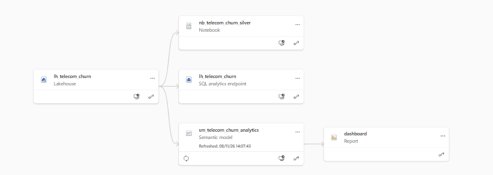
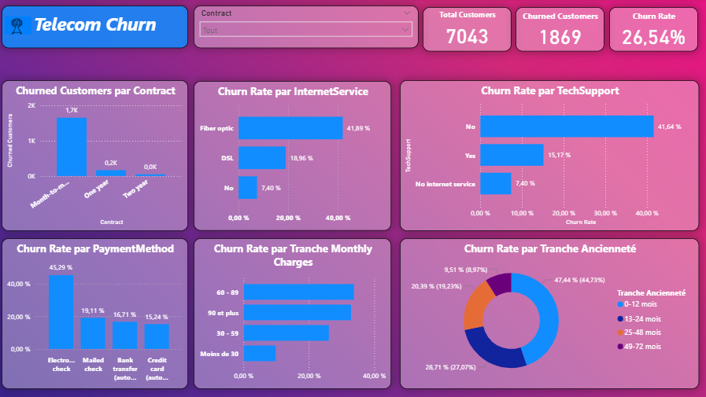

# Telecom Customer Churn Analytics | Microsoft Fabric & Power BI

An end-to-end data engineering and business intelligence project exploring customer churn in the telecommunications sector. The solution uses **Microsoft Fabric**, **PySpark**, **Delta tables**, a **semantic model**, and **Power BI** to turn raw customer data into actionable retention insights.

## Project objectives

- Measure customer churn and identify high-risk customer segments.
- Compare churn across contract types, internet services, technical support, payment methods, monthly charges, and customer tenure.
- Build a reproducible Bronze–Silver–Gold analytical workflow using PySpark.
- Present business KPIs in an interactive Power BI report.

## Tech stack

| Layer | Technologies |
| --- | --- |
| Storage and analytics | Microsoft Fabric Lakehouse, SQL analytics endpoint |
| Processing | Fabric Notebook, Python, PySpark |
| Tables | Delta Lake |
| Data modeling | Gold fact and dimension tables, Fabric semantic model |
| Visualization | Power BI |
| Source | Telecom customer churn dataset from Kaggle |

## Fabric architecture

The Fabric workspace lineage shows the Lakehouse linked to a Notebook, a SQL analytics endpoint, and the semantic model; the semantic model feeds the Power BI report.



### Data transformation workflow

1. **Bronze:** Read source CSV files from `Files/bronze/` in the Lakehouse.
2. **Silver:** Profile data quality, detect duplicate customer IDs and missing values, convert `TotalCharges` to numeric, apply validation rules, and save `silver_telecom_customers` as a Delta table.
3. **Gold:** Create analytical tables for customer churn reporting:
   - `gold_dim_customer` — customer attributes, services, and payment method.
   - `gold_dim_contract` — contract categories.
   - `gold_fact_customer_churn` — customer-level churn, tenure, and charges, with dimension keys.
4. **Reporting:** Use a Fabric semantic model and Power BI to explore churn metrics and customer segments.

The implementation is available in [`data_transformation.ipynb`](data_transformation.ipynb).

## Dashboard



### Key metrics

| KPI | Value |
| --- | ---: |
| Total customers | 7,043 |
| Churned customers | 1,869 |
| Churn rate | 26.54% |

The dashboard includes a contract filter and analyses of churn by contract, internet service, technical support, payment method, monthly charges, and tenure.

## Selected observations

- **Month-to-month contracts** account for most churned customers in the displayed contract breakdown.
- **Fiber-optic customers** show a higher churn rate than DSL customers in the dashboard.
- Customers **without technical support** show a higher churn rate than those with technical support.

These are descriptive patterns in the dataset, not causal conclusions.

## Repository contents

```text
.
├── README.md
├── data_transformation.ipynb
├── dashboard_overview.png
└── fabric_lineage.png
```

## Data source and reproducibility

Source: **Kaggle — Telecom Customer Churn dataset**. Add the exact dataset URL and license here once verified.

To reproduce the transformations, set up a Microsoft Fabric Lakehouse, upload the source CSV into `Files/bronze/`, attach the notebook to the Lakehouse, and run the notebook cells in order. A Fabric workspace and suitable permissions are required. The Power BI report and semantic model are hosted in Fabric; screenshots in this repository document the final output.

> Note: Do not publish credentials, tenant-specific secrets, or non-public customer data.
